<picture>
  <source media="(prefers-color-scheme: dark)" srcset="assets/hero-dark.svg" />
  <source media="(prefers-color-scheme: light)" srcset="assets/hero-light.svg" />
  
</picture>

[numan.fun](https://www.numan.fun) · [CV](https://www.numan.fun/cv.pdf) · [Repositories](https://github.com/byte4day?tab=repositories)

## Now

- [**GTA 6 Clipper**](https://github.com/byte4day/gta6-clipper): records 36 Twitch and YouTube streamers while they are live and turns the best moments into captioned 9:16 clips within a minute or two. Python with a Rust core.
- [**terminal-linux**](https://github.com/byte4day/terminal-linux): a separate Linux desktop for computer-use agents, viewed and controlled from a terminal.
- [**Copycat**](https://github.com/byte4day/Copycat): an agent skill that inspects a UI in a real browser, rebuilds it in your stack and diffs the result.
- [**nummode**](https://github.com/byte4day/nummode): paste a big prompt; it routes the right skills in Claude Code, Cursor and Codex, then verifies the work.
- [**Modu**](https://modu.ubits.tech): AI operator for Discord servers, Slack workspaces and WhatsApp numbers. Built at UBITS Technologies.
- [**Product Video**](https://github.com/byte4day/claude-video-skill): Claude Code plugin that takes a product or game from research and storyboard to a QA-gated MP4.
- [**DevOps Agent**](https://github.com/byte4day/devops-agent): deploy, debug and operate applications from your AI coding assistant.

## Also

[QuranFlow](https://github.com/byte4day/quranflow) · [Lost Island](https://github.com/byte4day/lost-island-archcraft-sway) · [AI Usage](https://github.com/byte4day/AI-Usage-Extension) · [PxForge](https://github.com/byte4day/PxForge) · [AyahPath](https://github.com/byte4day/AyahPath) · [WhiteBoard](https://github.com/byte4day/WhiteBoard) · [NezoPer](https://github.com/byte4day/NezoPer) · [bite-watch](https://github.com/byte4day/bite-watch) · [Claude-makeup-skill](https://github.com/byte4day/Claude-makeup-skill)
